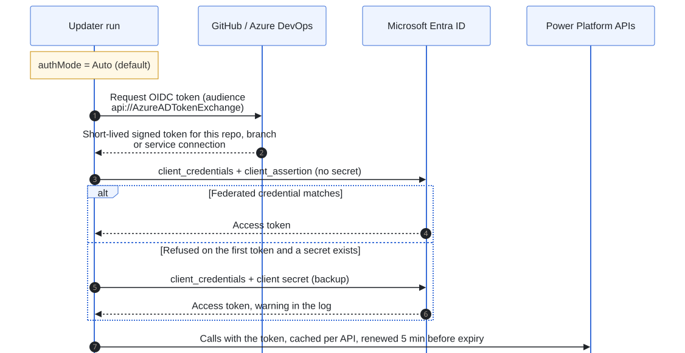
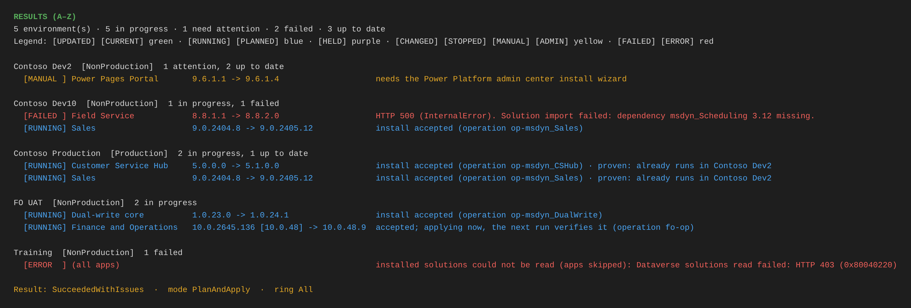
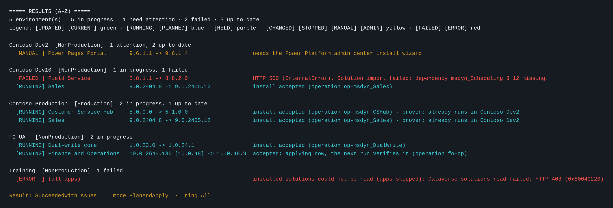
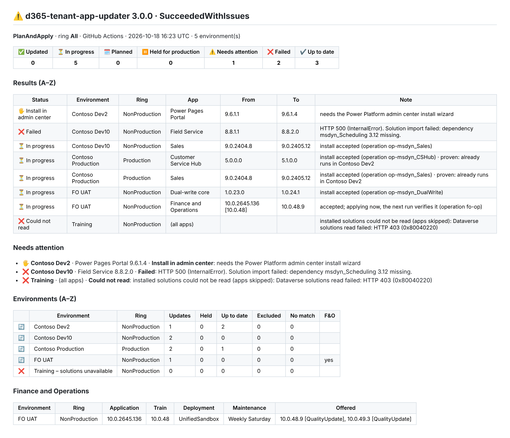

# Architecture

How d365-tenant-app-updater v3 is put together: what it talks to, how a run flows, and how it decides what to update. The diagrams are images rendered from the Mermaid sources in [diagrams/](diagrams/) (see [Editing the diagrams](#editing-the-diagrams)).

**Contents:** [System context](#1-system-context) | [Pipeline stages](#2-pipeline-stages) | [Production ring](#3-production-ring) | [Inside the module](#4-inside-the-module) | [App decision](#5-app-decision) | [F&O decision](#6-finance-and-operations-decision) | [Sign-in](#7-sign-in) | [What a run shows](#8-what-a-run-shows) | [Design rules](#design-rules)

## 1. System context


| Talks to | Why | Writes? |
|---|---|---|
| Microsoft Entra ID | Access tokens for the app registration (client secret, or a federated token from GitHub or Azure DevOps) | No |
| BAP admin API | The admin-wide list of environments, with their type (Production, Sandbox, ...) | No |
| Power Platform API, App Management | Apps available per environment, install, install status | **Install** |
| Power Platform API, F&O routes | Live build, offered versions, maintenance window | **Apply version** (only with `finOpsApplyVersion = true`) |
| Dataverse, per environment | Installed managed-solution versions: the source of truth for "installed" | No |
| Microsoft PQU schedule (raw.githubusercontent.com) | Which application build belongs to which F&O release | No |

Nothing is stored between runs. Every run reads the tenant fresh, so there is no state to drift or corrupt.

## 2. Pipeline stages



- **Plan** reads every environment A to Z and decides everything up front. It changes nothing and publishes `plan.json`, `summary.md` and `report.json`. When `whatIf` is on, wherever it is set, Plan reports no actions to the next stages, so both Apply stages are skipped and no approval is requested.
- **Apply non-production** and **Apply production** each take their part of the plan. Before every action they re-check the live tenant and the current settings, so a plan that waited for an approval never installs something different from what was approved. `plan.json` keeps a snapshot of the settings the plan was made with, so Apply can tell when one of them changed.
- The stages are the same on both platforms: `pipelines/templates/stages.yml` (Azure DevOps) and `.github/workflows/tenant-app-updater.yml` (GitHub). Production approval is optional on both: on Azure DevOps by naming an environment you created (`productionApprovalEnvironment`), on GitHub through the `d365-production` environment's required reviewers.
- A local or single-stage run (`-Mode PlanAndApply`, the default) does all three in one process.

## 3. Production ring



Non-production updates as soon as Microsoft offers something ("test and break fast"). Production takes a version only once a non-production environment already runs it. On a nightly schedule that means production is one night behind non-production. `productionSoakDays` makes the wait longer for apps. `productionRing = false` turns the ring off.

## 4. Inside the module



| File | Responsibility |
|---|---|
| `scripts/Update-TenantApps.ps1` | Entry point used by both platforms. Same parameters as v2. |
| `Main.ps1` | `Invoke-D365TenantAppUpdate`: the run, the three modes, the exit code. |
| `Settings.ps1` | Every setting: parameter, then queue-time override, then variable, then default. Safety switches keep their safe value on a typo. |
| `Auth.ps1` | Client secret or federated sign-in, token cache, renewal before expiry. |
| `Discovery.ps1` | Environments A to Z, filter and exclude, ring per environment. |
| `Apps.ps1`, `FinOps.ps1` | Collect (read only), then decide per app / per F&O environment. |
| `Plan.ps1` | Builds the plan and orders it: non-production first, then A to Z. |
| `Apply.ps1` | Settings gate, re-validation, install / apply, waiting for installs. |
| `Report.ps1` | The results board in the log, `summary.md`, `report.json`. |
| `Host.ps1` | The only file that knows Azure DevOps from GitHub: colours, groups, warnings, outputs, run result. |
| `Http.ps1` | The only HTTP caller. Never throws. Retries GET on 429/503. Never retries a POST. |

**Collect, decide, act.** Decisions are plain functions of collected data. That is what lets the production ring look at every environment before deciding any of them, keeps the order A to Z independent of the API's order, and lets over 150 tests run against a fake tenant without contacting Microsoft.

## 5. App decision


## 6. Finance and Operations decision


The F&O Provisioning App's Anchor Solution only tells the run that F&O is installed. Its version is never used: Microsoft only updates it for Lifecycle Services updates.

## 7. Sign-in



## 8. What a run shows

The last view in the log is the **results board**: every environment A to Z, and under it one colour-coded line per app that was updated, is updating, is held or failed. Each line starts with a fixed-width tag, so it reads the same without colour.

| Tag | Colour | Meaning |
|---|---|---|
| `[UPDATED]` `[CURRENT]` | green | Installed and finished / already at the version |
| `[RUNNING]` `[PLANNED]` `[RETRY]` | blue | Still installing (checked again next run) / planned in a Plan run / retry of an install that failed in Power Platform (Retry planned, Retry started) |
| `[HELD]` | purple | Held for production: not proven in non-production yet |
| `[CHANGED]` `[STOPPED]` `[MANUAL]` `[ADMIN]` | yellow | Changed since plan / Stopped by settings / Install in admin center / environment in admin mode |
| `[FAILED]` `[ERROR]` | red | Install failed / environment could not be read |

Azure DevOps:



GitHub Actions:



A retry of a failed install has an empty **From** and the note "Last install failed in Power Platform. If it keeps failing, install it from the admin center."

The **run summary** (Azure DevOps Extensions tab, GitHub job summary) opens with counters and one A to Z list with the same statuses. On Azure DevOps each stage adds its own section:

- **1. Plan - what was found and decided** has the full inventory: every environment, held production updates, and Finance and Operations.
- **2. Apply non-production - what was started** and **3. Apply production - what was started** list only what that stage did.

The **Environments** table always shows **Updates** and **Up to date**. **Held**, **Excluded** and **No match** appear only when some environment has a non-zero value. The **Finance and Operations** table has a **Status** column per environment, for example "No newer version", "LCS managed", "Inventory only", "Planned: 10.0.48.8" or "Held: ..." with the reason. A column that is empty for every environment (often Maintenance or Offered) is hidden.



The screenshots come from a demo run against the test suite's fake tenant. The environment names are made up.

## Design rules

These hold everywhere in the code, and the tests check them:

1. **Never a downgrade, never an app that is not installed, never blind.** An app is updated only when it is installed, its installed version is known from Dataverse, and the available version is strictly newer.
2. **Production waits for proof** (unless `productionRing = false`).
3. **Fail safe.** Unknown release train, unknown environment type, mistyped safety switch, unreadable version list: the run holds back and says why, rather than guessing.
4. **One switch per destructive capability.** Only `finOpsApplyVersion` can apply an F&O version.
5. **Apply never improvises.** It executes the plan or reports why it did not (`CHANGED`, `CURRENT`, `STOPPED`). It never installs over an app whose installed version can no longer be read.
6. **A to Z everywhere**, with numbers in numeric order, the same on every agent and locale.
7. **No state between runs.** The tenant is the source of truth.

## Editing the diagrams

The sources are Mermaid text in [diagrams/](diagrams/). Edit a `.mmd` file, then render it to SVG and PNG with the same name in [images/](images/), for example:

```bash
npx -y @mermaid-js/mermaid-cli -c docs/diagrams/mermaid-config.json -b white \
  -i docs/diagrams/02-pipeline-stages.mmd -o docs/images/02-pipeline-stages.svg
```

or paste the source into https://mermaid.live and export. The SVGs are committed so the diagrams display on GitHub, in Azure Repos and anywhere else without a Mermaid renderer.
